<a href="https://github.com/Platane/snk">
<picture>
  <source media="(prefers-color-scheme: dark)" srcset="https://raw.githubusercontent.com/SeveringBaton12/SeveringBaton12/output/snake-dark.svg"/>
  
</picture>
</a>

